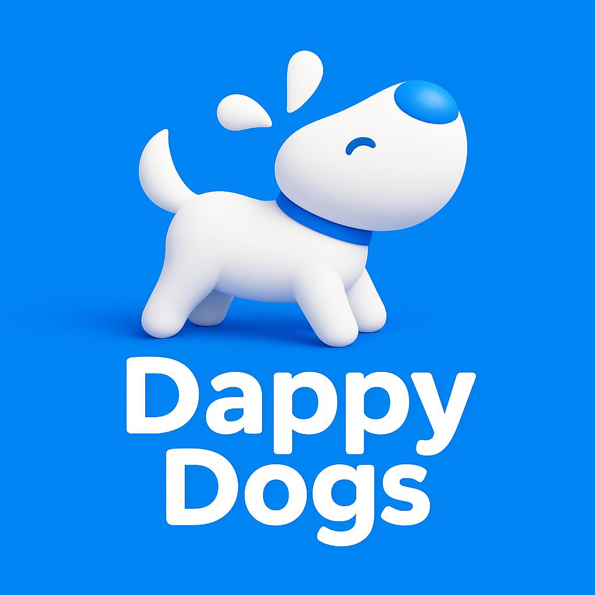
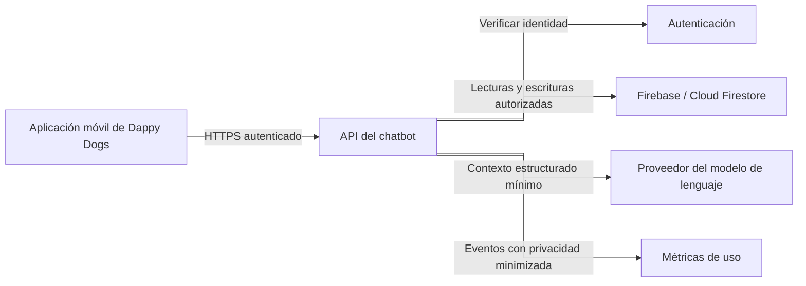

# API del chatbot de IA de Dappy Dogs


*Acceso conversacional al perfil, la actividad y los datos de cuidados de Dappy Dogs.*

Este repositorio contiene la API de backend y la capa de orquestación de IA del chatbot integrado en la aplicación móvil de Dappy Dogs. El servicio proporciona acceso controlado mediante lenguaje natural a perfiles de perros, paseos, estadísticas de actividad y registros de cuidados introducidos por sus responsables, preservando las fronteras de autenticación y aislamiento de datos.

## Contenido

- [Alcance](#alcance)
- [Principios fundamentales](#principios-fundamentales)
- [Arquitectura](#arquitectura)
- [Documentación](#documentación)
- [Desarrollo](#desarrollo)
- [Estado](#estado)
- [Licencia](#licencia)

## Alcance

El alcance inicial del producto incluye:

- Consultas sobre perfiles de perros, paseos y actividad registrada.
- Totales, promedios y comparaciones básicas de actividad calculados de forma determinista.
- Creación confirmada y consulta de registros de vacunación, desparasitación, medicación y citas.
- Instrumentación básica del uso del chatbot.

Quedan fuera del alcance inicial los diagnósticos veterinarios, las recomendaciones de tratamiento, el entrenamiento de modelos propietarios, la integración con dispositivos inteligentes, la extracción documental, la monitorización en tiempo real, las funcionalidades sociales, las notificaciones proactivas y la analítica avanzada.

## Principios fundamentales

- La identidad autenticada en el backend gobierna todo acceso a datos.
- Cada usuario solo puede acceder a sus propios perros autorizados y a los datos de su cuenta.
- El modelo de lenguaje nunca accede directamente a Firebase.
- Las acciones solicitadas por el modelo están incluidas en una lista permitida, tipadas, autorizadas y validadas por la aplicación.
- Los cambios en registros de cuidados requieren confirmación explícita del usuario antes de persistirse.
- Las estadísticas de actividad se calculan mediante código determinista de la aplicación.
- El chatbot no proporciona diagnósticos ni tratamientos veterinarios.
- Los logs y la telemetría excluyen secretos, conversaciones sin procesar y contenido sensible de los registros.

## Arquitectura

El servicio se plantea como una API modular en Python con fronteras explícitas entre el transporte HTTP, los casos de uso de aplicación, las políticas de dominio, la persistencia en Firebase, la autenticación, la telemetría y el proveedor del modelo de lenguaje.



FastAPI proporciona la frontera HTTP inicial de la aplicación. Los contratos de verificación de Firebase Auth y App Check están implementados. La inicialización en tiempo de ejecución, el despliegue, la autorización funcional y la integración con el proveedor del modelo quedan sujetos a sus correspondientes tareas de implementación y verificación.

## Documentación

- [Arquitectura del chatbot](docs/CHATBOT-ARCHITECTURE.md)
- [Autenticación y verificación de la aplicación](docs/AUTHENTICATION.md)
- [Frontera HTTP, errores y observabilidad](docs/HTTP-BOUNDARY.md)
- [Orquestación del modelo y registro de herramientas](docs/ORQUESTACION-DE-MODELO.md)
- [Capacidad conversacional de perfil](docs/CAPACIDAD-DE-PERFIL.md)
- [Acceso al perfil de usuario](docs/USER-PROFILE.md)
- [Base de datos de Firestore](docs/FIRESTORE-DATABASE.md)

## Desarrollo

El repositorio se encuentra en su fase de fundaciones. La interfaz estándar de comandos es:

```bash
make install-dev
make format
make format-check
make lint
make types
make test
make check
make run
```

En Windows, los comandos utilizan `.venv/Scripts/python.exe`; en sistemas POSIX utilizan `.venv/bin/python`.

## Estado

La versión `0.1.0` establece las fundaciones ejecutables del repositorio: paquete modular, configuración tipada, endpoints de salud, fronteras de verificación de Firebase Auth y App Check, una frontera HTTP observable y saneada, acceso defensivo de solo lectura al perfil, orquestación neutral al proveedor, registro cerrado de tools, capacidad conversacional de perfil, un adaptador temporal para Ollama y comprobaciones automáticas de calidad. Todavía no se incluyen un endpoint funcional del chatbot, las consultas de actividad, la integración desplegada con Firebase ni la selección del proveedor definitivo.

---

## Licencia

Este software ha sido desarrollado por **COLLYBRIX ACELERADORA, S.L.** por encargo de **DAPPY DOGS, S.L.**

Todos los derechos de propiedad intelectual e industrial sobre el código fuente, la documentación y los materiales asociados pertenecen exclusivamente a **DAPPY DOGS, S.L.**, de conformidad con los términos contractuales acordados por ambas partes.

El uso, la reproducción, la distribución o la modificación de este software, total o parcialmente, quedan estrictamente limitados a las operaciones internas de **DAPPY DOGS, S.L.**

Queda expresamente prohibida su cesión o puesta a disposición de terceros sin autorización previa y por escrito.

Copyright 2026 DAPPY DOGS, S.L.<br>
Desarrollado por **COLLYBRIX ACELERADORA, S.L.**
