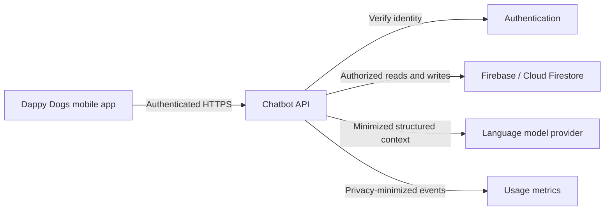

# Dappy Dogs AI Chatbot API


*Conversational access to Dappy Dogs profile, activity, and care data.*

This repository contains the backend API and AI orchestration layer for the chatbot integrated into the Dappy Dogs mobile application. The service provides controlled natural-language access to dog profiles, walks, activity statistics, and owner-provided care records while preserving authentication and data isolation boundaries.

## Contents

- [Scope](#scope)
- [Core principles](#core-principles)
- [Architecture](#architecture)
- [Documentation](#documentation)
- [Development](#development)
- [Status](#status)

## Scope

The initial product scope includes:

- Questions about dog profiles, walks, and recorded activity.
- Deterministic totals, averages, and basic activity comparisons.
- Confirmed creation and retrieval of vaccine, deworming, medication, and appointment records.
- Basic chatbot usage instrumentation.

Veterinary diagnosis, treatment recommendations, proprietary model training, smart-device integration, document extraction, real-time monitoring, social features, proactive notifications, and advanced analytics are outside the initial scope.

## Core principles

- The authenticated backend identity governs every data access.
- Users can access only their own authorized dogs and account data.
- The language model never accesses Firebase directly.
- Model-requested actions are allowlisted, typed, authorized, and validated by the application.
- Care-record changes require explicit user confirmation before persistence.
- Activity statistics are calculated by deterministic application code.
- The chatbot does not provide veterinary diagnoses or treatments.
- Logs and telemetry exclude secrets, raw conversations, and sensitive record contents.

## Architecture

The service is planned as a modular Python API with explicit boundaries between HTTP transport, application use cases, domain policies, Firebase persistence, authentication, telemetry, and the language-model provider.



FastAPI provides the initial HTTP application boundary. Firebase Auth and App Check verification contracts are implemented, while runtime initialization, deployment, functional authorization, and model-provider integration remain subject to their corresponding implementation and verification work.

## Documentation

- [Chatbot architecture](docs/CHATBOT-ARCHITECTURE.md)
- [Authentication and application verification](docs/AUTHENTICATION.md)
- [HTTP boundary, errors, and observability](docs/HTTP-BOUNDARY.md)
- [Firestore database](docs/FIRESTORE-DATABASE.md)

## Development

The repository is in its foundation stage. The standard command interface is:

```bash
make install-dev
make format
make format-check
make lint
make types
make test
make check
make run
```

On Windows, the commands use `.venv/Scripts/python.exe`; on POSIX systems, they use `.venv/bin/python`.

## Status

Version `0.1.0` establishes the executable repository foundation, including the modular package, typed settings, health endpoints, Firebase Auth and App Check verification boundaries, a sanitized and observable HTTP boundary, and automated quality checks. No functional chatbot endpoint, deployed Firebase integration, or model-provider integration is included yet.
