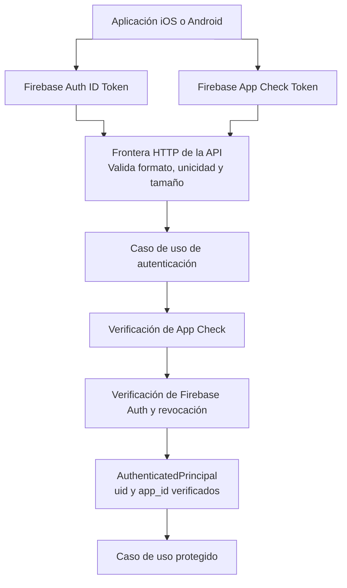

# Autenticación y verificación de la aplicación

## Estado del documento

Este documento describe el contrato de autenticación implementado por la API de Dappy Dogs. La frontera, los adaptadores y las pruebas automatizadas existen en el repositorio; la inicialización con credenciales del proyecto, la activación móvil de App Check, los endpoints funcionales protegidos y la verificación contra un entorno Firebase aislado permanecen pendientes.

## Objetivo

La API debe derivar la identidad efectiva exclusivamente de evidencias verificadas en el servidor. Un identificador enviado en el cuerpo, en una consulta, en una herramienta del modelo o en el historial conversacional nunca puede sustituir al usuario autenticado.

Cada petición protegida requiere dos evidencias independientes:

- Un Firebase Auth ID Token que identifica al usuario.
- Un Firebase App Check Token que acredita que la petición procede de una instancia válida de una aplicación registrada.

App Check complementa a Firebase Auth: no identifica al usuario ni concede acceso a datos por sí solo.

## Flujo de confianza



La verificación de App Check se realiza antes que la del usuario para rechazar clientes no válidos antes de ejecutar la comprobación de revocación de Firebase Auth.

## Contrato HTTP

Una petición protegida debe incluir exactamente una instancia de cada cabecera:

```http
Authorization: Bearer <firebase-id-token>
X-Firebase-AppCheck: <firebase-app-check-token>
```

La frontera aplica estas reglas antes de invocar cualquier caso de uso:

- El esquema de autorización debe ser `Bearer`.
- Ningún token puede estar vacío, contener espacios ni superar 8.192 caracteres.
- Las cabeceras duplicadas se rechazan para evitar interpretaciones ambiguas entre intermediarios.
- La ausencia de cualquiera de las dos evidencias impide ejecutar el endpoint protegido.
- Los tokens no se incluyen en representaciones internas destinadas a diagnóstico.

## Verificación de Firebase Auth

El adaptador usa Firebase Admin para verificar que el ID Token está firmado, vigente y emitido para el proyecto configurado. El SDK valida la firma, el emisor, la audiencia y la expiración. La API activa además `check_revoked`, por lo que se rechazan tokens revocados y usuarios deshabilitados.

Tras la verificación, el adaptador exige que `uid` y `sub` sean cadenas no vacías y coincidan. El resultado se transforma en un contrato interno sin tipos de Firebase.

## Verificación de App Check

App Check se aplica en modo estricto. No existe actualmente un modo permisivo o de monitorización en la API porque no se ha autorizado una transición que debilite esta frontera.

Firebase Admin valida la firma, los encabezados, el proyecto, la audiencia, el emisor y la expiración del token. La API exige además un `app_id` no vacío. Se aceptarán las aplicaciones registradas que pertenezcan al proyecto configurado; cualquier restricción adicional por plataforma deberá definirse mediante un contrato explícito antes de incorporarla.

## Principal autenticado

El resultado de ambas verificaciones es un `AuthenticatedPrincipal` inmutable:

```python
AuthenticatedPrincipal(
    uid="server-verified-user",
    app_id="server-verified-app",
)
```

Los repositorios y casos de uso futuros recibirán este principal desde la frontera HTTP. No deberán aceptar un `uid` autoritativo procedente del payload ni construir rutas de datos a partir de identificadores proporcionados por el modelo.

## Errores públicos

| Situación | Estado HTTP | Código público | Comportamiento |
| --- | ---: | --- | --- |
| Falta alguna evidencia | `401` | `authentication_required` | No se ejecuta el endpoint protegido |
| Evidencia mal formada, inválida, expirada, revocada o incompatible | `401` | `invalid_authentication` | No se revelan tokens, claims ni detalles del SDK |
| La aplicación no dispone de un autenticador configurado | `503` | `authentication_unavailable` | Se informa de indisponibilidad sin exponer configuración interna |

Las causas técnicas se conservan internamente mediante encadenamiento de excepciones, pero la respuesta pública contiene únicamente códigos y mensajes estables.

## Límites de responsabilidad

Esta implementación no realiza el inicio de sesión del usuario. Las aplicaciones móviles siguen siendo responsables de autenticarse con Firebase, renovar los ID Tokens, activar los SDK de App Check y enviar ambas evidencias en cada petición protegida.

La autenticación tampoco concede automáticamente acceso a cualquier documento. Cada capacidad deberá aplicar autorización server-side y limitar sus lecturas o escrituras al `uid` del principal y a los recursos expresamente permitidos. Las reglas de Firestore seguirán siendo defensa en profundidad, no la autoridad principal de la API.

## Integración operativa pendiente

Para utilizar esta frontera contra Firebase real todavía será necesario:

1. Inicializar Firebase Admin con la identidad y el proyecto del entorno autorizado.
2. Construir e inyectar el autenticador Firebase al crear la aplicación FastAPI.
3. Activar y configurar App Check en iOS y Android.
4. Incorporar las dependencias de autenticación en cada endpoint funcional protegido.
5. Ejecutar pruebas con identidades controladas y tokens reales en un entorno aislado, sin usar datos personales de producción.

Hasta completar esos pasos, el repositorio contiene el mecanismo verificable y sus contratos, pero no demuestra una sesión real ni una integración desplegada con Firebase.

## Evidencia automatizada

La suite cubre:

- Construcción e inmutabilidad del principal.
- Ausencia, duplicación, formato y tamaño de cabeceras.
- Tokens de usuario y aplicación inválidos.
- Revocación activada en la llamada a Firebase Auth.
- Claims ausentes, vacíos, incompatibles o de tipo incorrecto.
- Fallos al obtener claves de firma de App Check.
- Rechazo antes de ejecutar el endpoint protegido.
- Imposibilidad de sustituir el `uid` verificado mediante el payload.
- Sanitización de respuestas y exclusión de tokens del `repr` interno.

Las pruebas no realizan llamadas de red ni utilizan credenciales, tokens o documentos reales.
