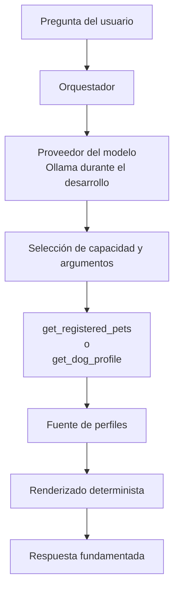

# Capacidad conversacional de perfil

## Propósito

Las capacidades `get_registered_pets` y `get_dog_profile` permiten consultar las mascotas del usuario autenticado y los atributos disponibles de sus perfiles. La identidad procede del servidor y no forma parte de los argumentos que puede generar el modelo.

## Flujo conversacional



Ninguna tool acepta `uid`, rutas de Firebase ni propiedades adicionales. Los repositorios reciben directamente el principal autenticado. El modelo selecciona la capacidad y, para el perfil, únicamente los campos necesarios; la aplicación renderiza la respuesta final de forma determinista y no devuelve los datos al modelo para una segunda redacción.

## Directorio de mascotas

`get_registered_pets` devuelve una colección `0..N` con el recuento total, una referencia interna por mascota y los nombres disponibles. El recuento es independiente del número de nombres incluidos, por lo que una consulta agregada de base de datos puede conservar el total real aunque la lista esté paginada. Permite responder preguntas de existencia, cantidad, listado y selección, por ejemplo «¿cuántas mascotas tengo?» o «¿cómo se llaman?». El contrato no limita el producto a una sola mascota.

Cuando el usuario menciona una mascota por su nombre, `get_dog_profile` recibe `pet_name` y el repositorio resuelve ese nombre exclusivamente dentro de las mascotas del principal autenticado. El nombre se compara sin distinguir mayúsculas y minúsculas; una selección inexistente devuelve `not_found`. La tool no acepta identificadores de usuario ni permite elegir mascotas de otra cuenta.

La fuente temporal basada en `Users/{uid}` solo puede producir cero o una porque el perro aparece embebido en ese documento. El adaptador definitivo deberá consultar la fuente multimascota real y aplicar su relación de propiedad cuando se identifiquen y validen su colección y estructura. Esta limitación de la fuente temporal no forma parte del contrato de producto.

El máximo técnico, la paginación y el número de nombres incluidos en una respuesta deberán configurarse cuando se conozcan la fuente real y los límites funcionales del producto. No se fija ahora un máximo arbitrario de mascotas ni se confunde ese límite operativo con el recuento real almacenado.

## Campos disponibles

| Campo de la tool | Información |
|---|---|
| `name` | Nombre del perro |
| `birth_date` | Fecha de nacimiento y precisión disponible |
| `breed` | Raza traducida o código numérico existente |
| `gender` | Sexo traducido o código numérico existente |
| `sociability` | Sociabilidad traducida o código numérico existente |
| `energy` | Nivel de energía traducido o código numérico existente |

La tool diferencia tres situaciones:

- `found`: existe el documento y se devuelven únicamente los campos solicitados.
- `not_found`: no existe un documento para el principal autenticado.
- Fallo de infraestructura: la fuente existe, pero no puede leerse o no cumple su contrato; se devuelve como error controlado y no como dato ausente.

Cada campo solicitado tiene estado `available` o `unavailable`. Los catálogos sin correspondencia móvil siguen estando disponibles con `value_type: catalog_code` y su valor numérico. La respuesta comunica ese código sin inferir una etiqueta.

El renderizado determinista impide que el modelo sustituya un código por una etiqueta inferida, añada hechos ajenos al resultado o convierta un valor disponible en información ausente. Una instrucción del usuario que solicite ignorar la tool no modifica este comportamiento.

## Catálogo inicial de preguntas

El flujo conversacional admite preguntas en lenguaje natural relacionadas con el directorio de mascotas y los seis campos de perfil anteriores. El inventario transversal de intenciones, variaciones representativas y capacidades planificadas se mantiene en [Catálogo general de consultas conversacionales](CATALOGO-DE-CONSULTAS.md).

Ejemplos específicos de esta capacidad:

- ¿Tengo mascota?
- ¿Cuántas mascotas tengo guardadas?
- ¿Solo tengo una mascota registrada?
- ¿Cómo se llama mi perro?
- ¿Cuándo nació mi perro?
- ¿Qué fecha de nacimiento tiene registrada?
- ¿Qué raza tiene mi perro?
- ¿Cuál es el sexo de mi perro?
- ¿Qué nivel de sociabilidad tiene?
- ¿Qué nivel de energía tiene?
- ¿Cómo se llama mi perro y qué raza tiene?
- ¿Qué raza tiene Dappy?

La edad calculada, los paseos, las estadísticas, la salud y las acciones de escritura todavía no forman parte de esta capacidad.

Los mensajes completos de saludo, agradecimiento o despedida se resuelven de forma determinista sin consultar el modelo ni la fuente de perfiles. Si el mensaje incluye además una pregunta funcional, continúa por el flujo conversacional ordinario.

## Ejecución con el fixture anonimizado

Ollama debe estar iniciado y contener el modelo configurado. La ejecución de una única pregunta es:

```powershell
.venv\Scripts\python.exe -m dappydogs_chatbot_api.chat `
  --users-directory "tests/fixtures/users" `
  --user-id "verified-user" `
  --question "¿Cómo se llama mi perro y qué raza tiene?"
```

Para mantener una conversación interactiva se omite `--question`:

```powershell
.venv\Scripts\python.exe -m dappydogs_chatbot_api.chat `
  --users-directory "tests/fixtures/users" `
  --user-id "verified-user"
```

El comando termina al escribir `exit` o `quit`.

El adaptador admite que Ollama serialice el array cerrado de campos como una cadena JSON. La cadena se decodifica antes de validarla, pero no se aceptan campos desconocidos, duplicados ni propiedades adicionales.

## Ejecución con una exportación local

La exportación debe conservar el formato `Users/<documentId>.json`. El identificador se solicita de forma interactiva para evitar incorporarlo al comando, al código, las pruebas, la documentación o Git:

```powershell
.venv\Scripts\python.exe -m dappydogs_chatbot_api.chat `
  --users-directory "<directorio-exportacion>/Users"
```

Esta herramienta utiliza exclusivamente archivos locales. No autentica contra Firebase, no consulta Firestore y no modifica la exportación.

## Limitaciones actuales

- El ejecutor local simula un principal autenticado para desarrollo; no sustituye la frontera HTTP con Firebase Auth y App Check.
- Ollama y `llama3.1:8b` son recursos temporales de desarrollo.
- Las correspondencias móviles de raza, sexo, sociabilidad y energía siguen pendientes.
- La ubicación y el esquema de la fuente real de múltiples mascotas todavía deben identificarse en las aplicaciones o en Firebase antes de implementar su consulta Firestore.
- El historial solo vive en memoria y se pierde al terminar el proceso.
- Todavía no existe un endpoint conversacional público.
