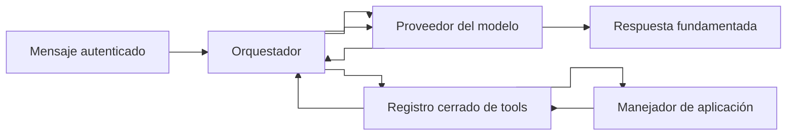

# Orquestación del modelo y registro de herramientas

## Propósito

La capa de orquestación procesa un turno conversacional sin conceder al modelo acceso directo a Firebase, autoridad sobre la identidad ni capacidad para ejecutar operaciones fuera del registro permitido. El núcleo utiliza contratos neutrales al proveedor; Ollama es únicamente el adaptador local inicial para desarrollo.

## Flujo controlado



El orquestador separa la instrucción del sistema, los mensajes del usuario, las solicitudes de tools y sus resultados. La identidad procede siempre del principal autenticado y se entrega directamente al manejador; nunca forma parte de los argumentos que puede generar el modelo.

## Registro cerrado de tools

Cada tool declara un nombre único, una descripción, un modelo de argumentos Pydantic con propiedades adicionales prohibidas y un manejador de aplicación. Antes de ejecutar un grupo de solicitudes se validan todas sus tools y argumentos, por lo que una solicitud desconocida o inválida impide ejecutar el grupo completo.

Los resultados se serializan como JSON estructurado y tienen un tamaño máximo. El modelo solamente recibe el resultado mínimo devuelto por el manejador. Las implementaciones concretas de las capacidades de perfil, actividad y salud pertenecen a sus tareas específicas y todavía no forman parte de este registro.

## Contexto conversacional

El almacén inicial mantiene el contexto en memoria, separado por usuario autenticado e identificador de conversación. El historial conserva como máximo veinte mensajes y expira tras treinta minutos. Este almacenamiento es deliberadamente temporal: no proporciona recuperación entre reinicios ni constituye un registro clínico o una fuente de autorización.

El turno limita el tamaño del mensaje y el número de rondas de tools. Los fallos del proveedor, las respuestas inválidas, las tools desconocidas, los argumentos adicionales y los límites excedidos se convierten en estados controlados sin ejecutar operaciones adicionales.

## Adaptador local de Ollama

El adaptador inicial utiliza la API HTTP de Ollama mediante `/api/chat` y soporta llamadas estructuradas a tools. Su selección es temporal para facilitar el desarrollo local y no determina el proveedor ni el modelo que se utilizarán en los entornos desplegados.

La configuración local inicial es:

```dotenv
DAPPYDOGS_MODEL_PROVIDER=ollama
DAPPYDOGS_MODEL_BASE_URL=http://127.0.0.1:11434
DAPPYDOGS_MODEL_NAME=llama3.1:8b
DAPPYDOGS_MODEL_TIMEOUT_SECONDS=120
```

La URL se configura explícitamente porque `localhost` puede representar destinos distintos cuando el servicio se ejecuta dentro de un contenedor. El timeout ampliado permite la carga en frío del modelo local y puede ajustarse sin modificar el código.

## Sustitución del proveedor

Un proveedor cloud deberá implementar el mismo puerto neutral de mensajes, tools, respuesta y uso. Sus SDK, tipos, credenciales y errores permanecerán dentro de su adaptador. La selección definitiva requerirá la evaluación prevista de calidad, tool calling, seguridad, latencia, privacidad y condiciones de tratamiento de datos.

## Estado actual

El contrato del orquestador, el registro cerrado, el contexto acotado y el adaptador Ollama están implementados y probados. También se ha verificado localmente que `llama3.1:8b` solicita una tool estructurada mediante Ollama. Aún no existe un endpoint público del chatbot, no se han registrado las capacidades funcionales y no se ha seleccionado el proveedor definitivo.
