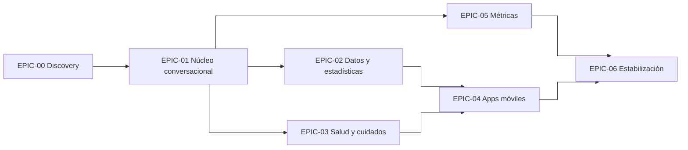

# Roadmap técnico — Dappy Dogs AI Chatbot API

## Propósito

Este roadmap organiza el trabajo correspondiente al repositorio `dappydogs-chatbot-api` a partir del discovery técnico. La planificación cubre exclusivamente el servicio de orquestación/API encargado de autenticar las peticiones móviles, interpretar de forma defensiva los datos heredados de Firebase, ejecutar capacidades deterministas, controlar la interacción con el modelo de IA y persistir operaciones confirmadas en las nuevas estructuras contratadas.

## Criterio de descomposición

- Nivel 1: épica.
- Nivel 2: historia de usuario.
- Nivel 3: tarea técnica.
- Las posibles subtareas se enumeran y explican dentro del alcance de cada tarea técnica; no se crean tickets de nivel inferior.
- Las decisiones todavía abiertas se mantienen como preguntas de refinamiento y no se presentan como contratos cerrados.
- Las fechas proceden del discovery y dependen de las decisiones de producto todavía abiertas y de la coordinación con los repositorios móviles; los accesos técnicos ya están concedidos.

## Autoridades de planificación y sincronización

- Milano es la autoridad para el estado del flujo de trabajo, la asignación a sprints, los responsables, las estimaciones, el estado de los hitos y las fechas objetivo.
- Este repositorio es la autoridad para el alcance técnico de la API, sus contratos, criterios de aceptación, dependencias, riesgos y estrategia de validación.
- La jerarquía compartida es proyecto, hito, épica, historia de usuario y tarea técnica. Los pasos de nivel inferior se enumeran dentro de cada tarea técnica.
- Una historia o tarea local recibe un identificador de Milano únicamente cuando el elemento correspondiente existe y se ha verificado. No se infieren identificadores, estimaciones ni asignaciones.
- El trabajo de implementación móvil puede aparecer en el plan transversal de Milano, pero no se implementa ni se registra como trabajo ejecutable dentro de este repositorio de la API.
- El estado `done` de Milano registra el cierre del flujo de trabajo; no cierra silenciosamente criterios de aceptación o decisiones de producto que sigan marcados como pendientes.

## Alcance del repositorio

El repositorio implementa la API autenticada, Firebase Auth y App Check, contratos descriptivos de las colecciones heredadas, adaptación de solo lectura de `Users` y `Routes`, estadísticas deterministas, herramientas cerradas, orquestación con el proveedor de IA, registros nuevos de salud y cuidados, confirmaciones idempotentes, seguridad veterinaria, límites de uso, observabilidad y métricas del servidor.

Quedan fuera de este repositorio las pantallas iOS y Android, la tarjeta visual de confirmación, la publicación en tiendas, la sustitución de `base.aar` y la remediación general de los sistemas heredados.

## Límite de responsabilidad sobre Firestore

- La API consumirá la base heredada tal como existe y no limpiará, corregirá, normalizará en origen, migrará, reestructurará ni eliminará sus documentos.
- Se documentarán y probarán todas las variaciones de `Users` y `Routes` que puedan afectar a las capacidades contratadas de perfil y actividad.
- `Friends`, `LikesReceived`, `LikesSended`, `Messages`, `MessagesIndices`, `Notifications` y `RoutePoops` quedan fuera: no se catalogan ni implementan mientras el catálogo validado no incorpore una capacidad contratada que las necesite.
- En el plan, «normalización» significa traducción en memoria desde documentos heredados a modelos canónicos; nunca implica una escritura sobre las colecciones actuales.
- Vacunación y salud constituyen persistencia nueva incluida en el contrato. Sus esquemas, tipos temporales, validación, reglas, índices, idempotencia y evolución se diseñarán correctamente desde el inicio, sin reproducir los patrones heredados.
- Cualquier saneamiento o remodelado de la base existente requiere alcance, estimación y contratación independientes.

## Plan por épicas

| Épica | Responsabilidad de este repositorio | Resultado esperado | Dependencias principales |
| --- | --- | --- | --- |
| [EPIC-00 — Discovery y cierre de alcance](epic/EPIC-00-discovery/EPIC-00.md) | Preparatoria y bloqueante | Aplicaciones existentes, modelo de datos, alcance contractual, arquitectura, riesgos, accesos y entorno local documentados mediante las cinco tareas de SPRINT-00 en Milano | Validación del catálogo y de las decisiones de producto todavía pendientes |
| [EPIC-01 — Fundaciones y núcleo conversacional](epic/EPIC-01-conversational-core/EPIC-01.md) | Completa | API segura desplegable, proveedor desacoplado, tools cerradas y límites veterinarios | EPIC-00, entorno cloud, App Check en las apps |
| [EPIC-02 — Consulta de datos y estadísticas](epic/EPIC-02-data-statistics/EPIC-02.md) | Completa | Esquemas heredados inventariados, adaptadores de lectura para perfil y paseos y estadísticas correctas | EPIC-00, EPIC-01, exportación de solo lectura, semántica móvil y catálogos canónicos |
| [EPIC-03 — Registro de salud y cuidados](epic/EPIC-03-health-care/EPIC-03.md) | Completa en servidor | Esquema seguro y flujos de propuesta, edición, confirmación, consulta y actualización | EPIC-01, campos de salud acordados, reglas e índices de Firestore |
| [EPIC-04 — Integración en iOS y Android](epic/EPIC-04-mobile-integration/EPIC-04.md) | Sin implementación interna | Contrato de integración consumido por ambas apps | EPIC-01, EPIC-02, EPIC-03 y coordinación con los equipos móviles |
| [EPIC-05 — Instrumentación y métricas](epic/EPIC-05-metrics/EPIC-05.md) | Parcial en servidor | Eventos sanitizados, consumo del proveedor y superficie de métricas acordada | EPIC-01 y taxonomía de eventos |
| [EPIC-06 — Estabilización y entrega](epic/EPIC-06-stabilization/EPIC-06.md) | Completa para la API | Catálogo verificado, seguridad validada, despliegue reproducible y documentación operativa | EPIC-01–EPIC-05 y versiones móviles integradas |

## Correspondencia verificada con Milano

Estado contrastado con Milano el 19 de noviembre de 2026. Los estados, sprints y fechas son volátiles y deben volver a verificarse antes de utilizarlos para ejecutar o comunicar el plan.

| Épica | Código de Milano | Estado en Milano | Carril de entrega | Descomposición ejecutable local |
| --- | --- | --- | --- | --- |
| EPIC-00 | `FD2DF4` | `done`; HU-00 y sus cinco tareas están `done`; el hito continúa manualmente `delayed` | SPRINT-00 | HU-00 (`FD2E12`) y cinco tareas con código Milano; pendiente reasignar manualmente las tareas bajo HU-00 |
| EPIC-01 | `FD2DF8` | `todo` | SPRINT-01 | US-01, US-02 y sus tareas técnicas |
| EPIC-02 | `FD2DFC` | `todo` | Inicio en SPRINT-01 y finalización en SPRINT-02 | US-03, US-04 y sus tareas técnicas |
| EPIC-03 | `FD2E00` | `todo` | Carril de servidor de SPRINT-02 | US-05, US-06 y sus tareas técnicas |
| EPIC-04 | `FD2E04` | `todo` | Inicio iOS en SPRINT-02 y carril móvil en SPRINT-03 | Sin trabajo ejecutable en este repositorio; la épica documenta los paquetes externos de trabajo móvil |
| EPIC-05 | `FD2E08` | `todo` | Carril de servicio y analítica de SPRINT-03 | US-07, US-08 y sus tareas técnicas; los eventos exclusivamente móviles permanecen fuera del repositorio |
| EPIC-06 | `FD2E0D` | `todo` | SPRINT-04 | US-09, US-10 y sus tareas técnicas |

## Estimación en Story Points

Los Story Points de cada historia son la suma de sus tareas técnicas. EPIC-04 queda pendiente del refinamiento móvil de sus propias US y TASK.

| Historia | TASK | Story Points |
| --- | --- | ---: |
| US-01 | `FD2E56` (3), `FD2E5A` (5), `FD2E5E` (3), `FD2E62` (3) | 14 |
| US-02 | `FD2E66` (3), `FD2E6A` (8), `FD2E6E` (5) | 16 |
| US-03 | `FD2E72` (5), `FD2E76` (3) | 8 |
| US-04 | `FD2E7A` (5), `FD2E7E` (5), `FD2E82` (3) | 13 |
| US-05 | `FD2E86` (5), `FD2E8A` (3) | 8 |
| US-06 | `FD2E8E` (5), `FD2E92` (8), `FD2E96` (5) | 18 |
| US-07 | `FD2E9A` (3), `FD2E9F` (5) | 8 |
| US-08 | `FD2EA4` (5), `FD2EA9` (3) | 8 |
| US-09 | `FD2EAE` (5), `FD2EB3` (8) | 13 |
| US-10 | `FD2EB8` (5), `FD2EBD` (3) | 8 |

## Secuencia de ejecución

EPIC-02 y EPIC-03 pueden avanzar en paralelo una vez estabilizados autenticación, autorización, errores y contratos de tools de EPIC-01. EPIC-05 comienza con la instrumentación del servicio y se completa cuando se decida el formato de consulta de métricas. EPIC-00 replica las cinco tareas completadas de SPRINT-00 en Milano; su cierre administrativo no resuelve la validación del catálogo y de las decisiones que siguen pendientes.

## Distribución por sprints

La distribución conserva el marco de entrega de Milano y hace explícitas las dependencias técnicas. La asociación a un sprint es un objetivo de planificación, no evidencia de que el elemento esté refinado, comprometido o listo para ejecutarse.

| Carril | Ventana de Milano | Trabajo técnico de la API | Trabajo externo o transversal | Evidencia de salida |
| --- | --- | --- | --- | --- |
| SPRINT-00 | 27 de octubre–10 de noviembre de 2026 | Discovery técnico, arquitectura, alcance y accesos | Revisión de las aplicaciones móviles y sesión de discovery con el cliente | Informe de discovery, roadmap y base técnica inicial |
| SPRINT-01 | 10–27 de noviembre de 2026 | EPIC-01 TASK-FD2E56–TASK-FD2E6E; EPIC-02 TASK-FD2E72–TASK-FD2E76; establecer en TASK-FD2EAE los identificadores del catálogo y el contrato de fixtures | Confirmar con ambos equipos móviles la semántica de `Users`, Auth, App Check, transporte, reintentos, cancelación y errores | Consulta autenticada de perfil reproducible sin modificar Firestore |
| SPRINT-02 | 30 de noviembre–4 de diciembre de 2026 | EPIC-02 TASK-FD2E7A–TASK-FD2E82; EPIC-03 TASK-FD2E86–TASK-FD2E96; añadir a TASK-FD2EAE datos de prueba y resultados deterministas de EPIC-02 y EPIC-03 | Coordinar la primera integración iOS y el contrato de confirmación de salud | Catálogo de actividad y primer flujo validado de propuesta y confirmación de salud sobre datos controlados |
| SPRINT-03 | 7–11 de diciembre de 2026 | EPIC-05 TASK-FD2E9A–TASK-FD2EA9; añadir a TASK-FD2EAE escenarios de integración y fallo | Ejecutar en paralelo los paquetes iOS y Android de EPIC-04 y producir evidencia de TestFlight y prueba interna de Google Play | Ambos clientes consumen el contrato estable; están disponibles la superficie de métricas autorizada y la evidencia de pruebas móviles |
| SPRINT-04 | 14–18 de diciembre de 2026 | EPIC-06 TASK-FD2EAE–TASK-FD2EBD | Aceptación extremo a extremo y traspaso conjuntos | Informe del catálogo, evidencia de seguridad y resiliencia, despliegue reproducible, documentación técnica y acta de entrega |

La integración móvil puede avanzar en paralelo cuando el contrato de una capacidad sea estable, pero las ventanas de ejecución principal de la API quedan secuenciadas para no asignar simultáneamente EPIC-02/EPIC-03 y EPIC-05/EPIC-06 al mismo equipo de servidor.

## Hitos del discovery

| Fecha objetivo | Hito | Aportación de la API |
| --- | --- | --- |
| 10/11/2026 | Alcance cerrado | Catálogo, accesos, políticas de uso y proveedor suficientemente definidos |
| 27/11/2026 | Demo del núcleo conversacional | Primera consulta de perfil autenticada en el entorno de desarrollo |
| 04/12/2026 | Demo de consultas y estadísticas | Catálogo principal operativo y primera propuesta de salud |
| 11/12/2026 | Versiones móviles de prueba | Contratos API estables para el flujo completo |
| 18/12/2026 | Entrega | API desplegada, verificada, observable y documentada |

Las fechas son objetivos condicionados por la validación del catálogo, las decisiones pendientes y la integración móvil. El proveedor se selecciona durante TASK-FD2E66, tal como prevé el discovery.

## Dependencias críticas

- Los accesos a Firebase y Google Cloud ya están concedidos; durante las tareas correspondientes debe verificarse la configuración efectiva de reglas, índices, región, cuotas y App Check.
- Proyecto de desarrollo separado o protocolo explícito de aislamiento de usuarios y escrituras.
- Semántica confirmada por iOS y Android para catálogos, campos dinámicos, identificadores duplicados y serialización de coordenadas.
- Catálogos numéricos canónicos de raza, sexo, sociabilidad y energía.
- Confirmación del contrato temporal y de unidades de `Routes` frente a ambos productores móviles.
- Catálogo validado de 15–25 consultas y acciones.
- Decisiones sobre idiomas, acceso general o premium, cuotas, retención y campos mínimos de salud.
- Evaluación y selección del proveedor de IA.
- Contrato de integración móvil, incluyendo streaming, reintentos, edición y confirmación.

## Criterios globales de entrega

- Una petición sin Firebase Auth válido o sin App Check válido se rechaza.
- Ningún usuario puede leer o modificar datos de otra cuenta.
- El modelo no accede directamente a Firebase ni ejecuta tools fuera del catálogo cerrado.
- Las cifras de actividad se calculan por código y se verifican contra datos controlados.
- Todos los esquemas heredados observados están representados por contratos de lectura y fixtures, sin escrituras de reparación sobre la base actual.
- Ninguna escritura de salud se realiza sin una propuesta validada y una confirmación idempotente.
- Las nuevas estructuras de salud usan campos estables, tipos temporales definidos, esquema versionado, reglas e índices probados.
- Las solicitudes veterinarias prohibidas reciben la respuesta segura acordada.
- Registros, trazas y métricas no contienen mensajes, instrucciones del modelo, tokens, ubicaciones ni datos de salud.
- El catálogo acordado se verifica de extremo a extremo sin errores críticos abiertos.

## Convención documental

Cada carpeta `EPIC-XX-*` contiene su documento `EPIC-XX.md` y una carpeta por historia de usuario. EPIC-00 contiene HU-00 porque replica el discovery ya ejecutado; las historias planificadas restantes se numeran como `US-01`–`US-10`. Cada carpeta de historia contiene su documento y sus tareas técnicas. Las tareas usan `TASK-<código-Milano>-*` cuando ya existen en remoto; las tareas todavía no creadas mantienen un nombre provisional sin valor contractual hasta recibir dicho código. Cada documento conserva la trazabilidad con Milano.

Las épicas de Milano definen el marco de entrega. Las historias de usuario y tareas técnicas locales definen la ejecución de la API. Al replicarlas en Milano deben conservarse la épica padre, el límite de propiedad, las dependencias y los criterios de aceptación, sin trasladar trabajo móvil a este repositorio.
