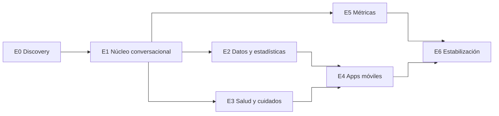

# Roadmap técnico — Dappy Dogs AI Chatbot API

## Propósito

Este roadmap organiza el trabajo correspondiente al repositorio `dappydogs-chatbot-api` a partir del discovery técnico. La planificación cubre exclusivamente el servicio de orquestación/API encargado de autenticar las peticiones móviles, normalizar datos de Firebase, ejecutar capacidades deterministas, controlar la interacción con el modelo de IA y persistir operaciones confirmadas.

## Criterio de descomposición

- Nivel 1: épica.
- Nivel 2: historia de usuario.
- Nivel 3: tarea técnica.
- Las posibles subtareas se enumeran y explican dentro del alcance de cada tarea técnica; no se crean tickets de nivel inferior.
- Las decisiones todavía abiertas se mantienen como preguntas de refinamiento y no se presentan como contratos cerrados.
- Las fechas proceden del discovery y dependen de accesos, decisiones de producto y coordinación con los repositorios móviles.

## Alcance del repositorio

El repositorio implementa la API autenticada, Firebase Auth y App Check, normalización de `Users` y `Routes`, estadísticas deterministas, tools cerradas, orquestación con el proveedor de IA, registros de salud y cuidados, confirmaciones idempotentes, seguridad veterinaria, límites de uso, observabilidad y métricas server-side.

Quedan fuera de este repositorio las pantallas iOS y Android, la tarjeta visual de confirmación, la publicación en tiendas, la sustitución de `base.aar` y la remediación general de los sistemas heredados.

## Plan por épicas

| Épica | Responsabilidad de este repositorio | Resultado esperado | Dependencias principales |
| --- | --- | --- | --- |
| [E0 — Discovery and project baseline](epic/E0-discovery/EPIC.md) | Preparatory and blocking | Existing applications, data model, contractual scope, architecture, risks and local environment documented through the three Milano discovery tasks | Repository access and local mobile build environment; Firebase/Google Cloud access, catalogue validation and product decisions remain downstream dependencies |
| [E1 — Fundaciones y núcleo conversacional](epic/E1-conversational-core/EPIC.md) | Completa | API segura desplegable, proveedor desacoplado, tools cerradas y límites veterinarios | E0, entorno cloud, App Check en las apps |
| [E2 — Consulta de datos y estadísticas](epic/E2-data-statistics/EPIC.md) | Completa | Consultas de perfil y paseos con estadísticas correctas y respuestas fundamentadas | E0, E1, documentos reales anonimizados y catálogos canónicos |
| [E3 — Registro de salud y cuidados](epic/E3-health-care/EPIC.md) | Completa en backend | Esquema seguro y flujos de propuesta, edición, confirmación, consulta y actualización | E1, campos de salud acordados, reglas e índices de Firestore |
| [E4 — Integración en iOS y Android](epic/E4-mobile-integration/EPIC.md) | Sin implementación interna | Contrato de integración consumido por ambas apps | E1, E2, E3 y coordinación con los equipos móviles |
| [E5 — Instrumentación y métricas](epic/E5-metrics/EPIC.md) | Parcial server-side | Eventos sanitizados, consumo del proveedor y superficie de métricas acordada | E1, taxonomía de eventos y decisión sobre la vista |
| [E6 — Estabilización y entrega](epic/E6-stabilization/EPIC.md) | Completa para la API | Catálogo verificado, seguridad validada, despliegue reproducible y documentación operativa | E1–E5 y versiones móviles integradas |

## Secuencia de ejecución

E2 y E3 pueden avanzar en paralelo una vez estabilizados autenticación, autorización, errores y contratos de tools de E1. E5 comienza con la instrumentación del servicio y se completa cuando se decida el formato de consulta de métricas. E0 replica las tres tareas del `Discovery Sprint` de Milano sin alterar su estado `in_review`; las decisiones y evidencias que el informe mantiene abiertas siguen siendo dependencias del trabajo posterior.

## Hitos del discovery

| Fecha objetivo | Hito | Aportación de la API |
| --- | --- | --- |
| 10/11/2026 | Alcance cerrado | Catálogo, accesos, políticas de uso y proveedor suficientemente definidos |
| 27/11/2026 | Demo del núcleo conversacional | Primera consulta de perfil autenticada en el entorno de desarrollo |
| 04/12/2026 | Demo de consultas y estadísticas | Catálogo principal operativo y primera propuesta de salud |
| 11/12/2026 | Versiones móviles de prueba | Contratos API estables para el flujo completo |
| 18/12/2026 | Entrega | API desplegada, verificada, observable y documentada |

Las fechas son objetivos condicionados por la disponibilidad de accesos, la validación del catálogo, las decisiones pendientes y la integración móvil.

## Dependencias críticas

- Acceso a Firebase y Google Cloud, incluyendo reglas, índices, región y configuración de App Check.
- Proyecto de desarrollo separado o protocolo explícito de aislamiento de usuarios y escrituras.
- Documentos anonimizados representativos de `Users` y `Routes`.
- Catálogos numéricos canónicos de raza, sexo, sociabilidad y energía.
- Confirmación de unidades y formatos de timestamps de rutas.
- Catálogo validado de 15–25 consultas y acciones.
- Decisiones sobre idiomas, acceso general o premium, cuotas, retención y campos mínimos de salud.
- Evaluación y selección del proveedor de IA.
- Contrato de integración móvil, incluyendo streaming, reintentos, edición y confirmación.

## Criterios globales de entrega

- Una petición sin Firebase Auth válido o sin App Check válido se rechaza.
- Ningún usuario puede leer o modificar datos de otra cuenta.
- El modelo no accede directamente a Firebase ni ejecuta tools fuera del catálogo cerrado.
- Las cifras de actividad se calculan por código y se verifican contra datos controlados.
- Ninguna escritura de salud se realiza sin una propuesta validada y una confirmación idempotente.
- Las solicitudes veterinarias prohibidas reciben la respuesta segura acordada.
- Logs, trazas y métricas no contienen mensajes, prompts, tokens, ubicaciones ni datos de salud.
- El catálogo acordado se verifica de extremo a extremo sin errores críticos abiertos.

## Convención documental

Cada carpeta de épica contiene `EPIC.md` y, según su descomposición, historias `US-XX-*.md` o tareas `TASK-XX-*.md`. Los nombres de archivo son locales a este plan. Cuando una tarea replica trabajo ya registrado en Milano, el documento conserva también su código de Milano como referencia explícita de trazabilidad.
